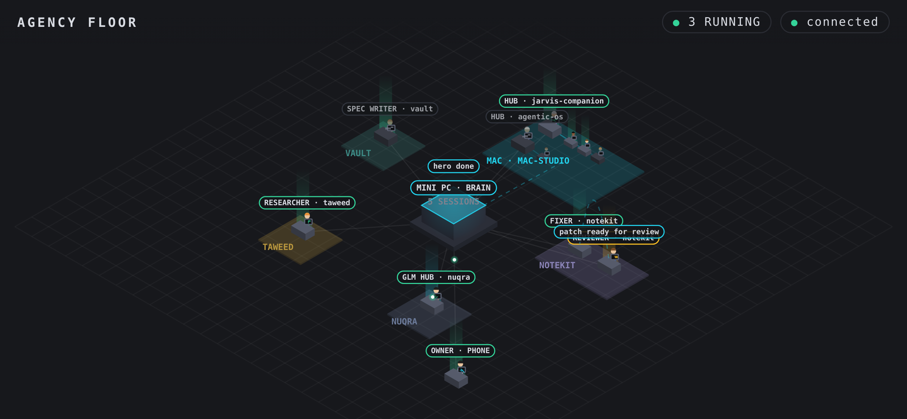
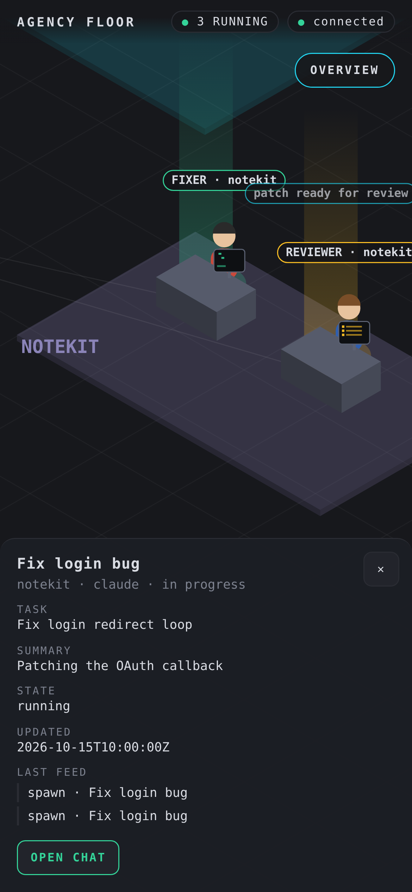
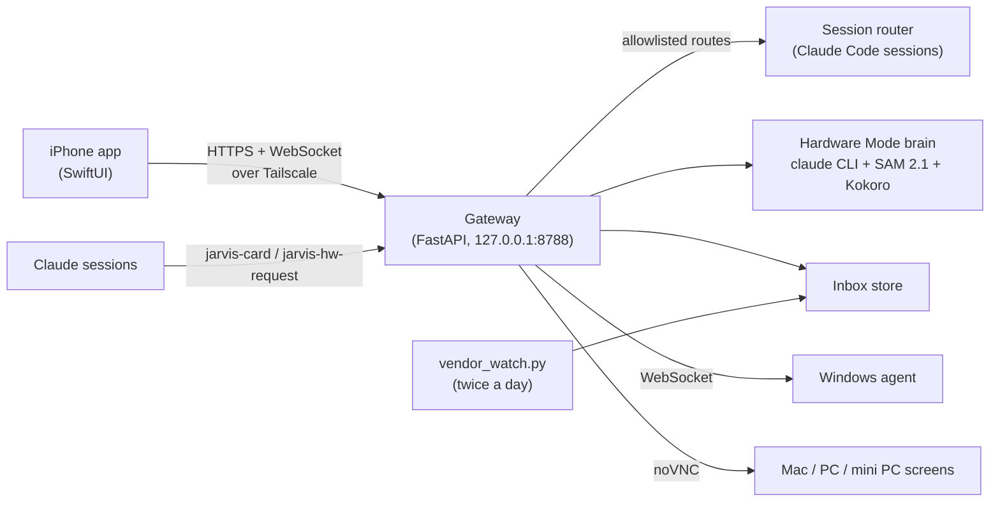

<div align="center">

# Jarvis Companion

**Run a fleet of Claude Code sessions from your iPhone.**
See every agent on one live floor, answer their questions with one tap,
let them ask you to plug in a cable, and only read the email that needs you.




</div>

You start ten Claude Code sessions across a Mac, a Windows PC and a headless mini PC.
Twenty minutes later one is waiting on a yes/no, one finished, one is stuck, and you are
on the couch with your phone. Jarvis Companion is the phone side of that setup: a SwiftUI
app plus a small FastAPI gateway that runs on your own machines and talks over Tailscale.
No hosted server, no account, no telemetry. The models run on your own Claude login.

## What it does

### 🏢 The Floor: your agents as an office

A live isometric view of every session. Each project is a room; each session is a worker
at a desk, drawn with a sprite for its role: planner with a clipboard, fixer with a
toolbox, reviewer with a magnifier, researcher with books, security with a shield. Speech
bubbles show what each one just said. Lines between desks are real messages between
sessions, streamed from the router's feed. Sub-sessions sit next to the session that
spawned them, so you can see who delegated to whom.



Tap a worker to get its task, a plain-words summary, its state, the last feed lines and
**Open chat**. Zoom into one room; tap **Overview** to go back.

The whole floor is one HTML file (`gateway/static/floor.html`): canvas, no build step,
no external assets.

<br clear="right">

### 💬 Interactive sessions: agents ask, you tap

Any session puts a card on your phone with one shell command:

```bash
jarvis-card doing "Building the card layout"
jarvis-card ask approve "Plan ready" --file plan.md          # Approve / Revise
jarvis-card ask choice "Which voice?" --option Daniel --option George
jarvis-card ask yesno "Restart the gateway now?"
jarvis-card ask checklist "Test on your phone" --item "Open the board" --item "Tap Approve"
jarvis-card ask preview "New header" --file shot.png         # Looks good / Change it
jarvis-card delegate CHILD_SESSION_ID "handed notifications"
```

Your tap goes back into that session as a normal message and the agent carries on.
No terminal, no SSH, no copy-paste.

The Sessions board is a kanban: In progress, Needs you, Done, plus a red Attention lane
for stuck or failed sessions. Every card has:

- **One plain line** of what it is doing now, and a short recap. A small Haiku call
  rewrites the agent's last reply into plain words, so "Now I'll update REPORT.md" never
  shows up as a status.
- **An honest health line**: "Working, last activity 20s ago", "Waiting for you",
  "Stalled, no activity 14 min". A session that says DONE but fails its done-check gets an
  amber *check* badge instead of a green tick.
- **Files** the session attached: plans, reports, screenshots, PDFs.
- **Chat**: open the thread, type, attach a photo or file, send.

When a session needs you, the phone rings: an in-app note, a push from your own
[ntfy](https://ntfy.sh) server, or WhatsApp-to-self when the app is asleep. Notes sent
while you were offline are caught up when you open the app.

### 🔧 Hardware Mode: an agent that sees through your camera

Point the phone at a PC case, a Raspberry Pi or an Arduino and talk. Jarvis looks at the
live frame, answers out loud in a sentence or two, and **draws on the part**: a tight box,
an arrow for the motion (press, pull, slide, rotate, plug), and a step card ("Step 3 of 7").
The overlay stays on the part as you move the phone.

- Put a finger on a connector and ask "is this it?". It answers about *that* spot.
- It sees when a step is already done in the picture and moves on.
- **SAM 2.1** (Hiera-Tiny, ONNX, CPU) turns the box into the part's real outline, about
  30 ms per mask.
- The voice is **Kokoro** TTS running locally (British `bm_daniel`). Without the model
  files the phone uses its own voice.
- The brain is a stripped-down `claude` CLI session: own system prompt, no tools, no MCP.
  A turn costs about 1-2k tokens and comes back in about a second. Frames alone never
  call the model; only your question does.

**Your other agents can ask for hands.** A coding session that needs a cable reseated runs
`jarvis-hw-request`. Its card on your phone shows **Open Hardware Mode**; you do the
physical step with Jarvis guiding you, and the summary goes back to that session.

### 📥 Focused inbox: only the mail that needs you

Not another email client. A watcher reads your inboxes twice a day and keeps **only mail
from senders you listed**: vendors, suppliers, your accountant. Each email is summarised
against a plain-text `context.md` you write about your business, into:

- one or two sentences on who wrote and what *this* email is about, and
- up to three **next steps you have to take because of it**. No invented steps. If the
  ball is in their court, it says "waiting on X".

On the phone, tick the steps you want done, type "start on these", and the email plus the
picked steps go to a new Claude session. The email body is fenced off as untrusted data on
the way, so a hostile email cannot steer the agent. A run with no new mail makes zero LLM
calls.

### Also in the box

- **Remote screen**: drive the Mac, Windows PC or mini PC desktop from the phone (noVNC
  through the gateway).
- **"Hey Jarvis"**: wake word on Mac and Windows (openWakeWord), Siri Shortcut on iPhone.
- **Windows agent**: query and control the PC by voice or from a Claude session.
- **iPhone Mirroring driver**: lets an agent tap through an iPhone app from the Mac.
- **One-tap handoffs** for flight booking and sign-in flows.

## How it fits together



- **The phone holds one token** (`ios_token`) and never sees the router's token. Each phone
  route maps to exactly one router call; there is no generic passthrough.
- **Sessions use a separate shared token**, read in-process and never printed.
- **Nothing faces the internet.** The gateway binds to loopback; `tailscale serve` puts TLS
  in front of it for your tailnet only.

## Try the Floor in a minute

No phone, router or tokens needed. The demo runs the real gateway on canned data:

```bash
git clone https://github.com/HXSmc/jarvis-companion.git && cd jarvis-companion
python3 -m venv .venv && .venv/bin/pip install fastapi uvicorn websockets httpx pyDes psutil
.venv/bin/python -m gateway.stubs.floor_demo 8899
```

Then open `http://127.0.0.1:8899/central/floor` with
`window.__JARVIS = {token: "demo-ios-token"}` set before the page loads. The iOS app does
this with a `WKUserScript`; on desktop use a userscript at `document-start` or Playwright's
`add_init_script`. Loopback only, fake tokens.

## Full setup

| Piece | Where | Notes |
|---|---|---|
| Gateway | an always-on Mac or Linux box | Python 3.11+, `pip install -e .` |
| Tailscale | every device | `scripts/serve.sh` publishes the gateway on your tailnet |
| Claude Code | the box that runs sessions | your own login, `claude` on `PATH` |
| iPhone app | `ios/JarvisCompanion` | free Apple ID; sideload with Xcode or AltStore. CI builds an unsigned IPA on every push to `ci-ipa` |
| Session router | the box that runs sessions | **not in this repo yet.** The gateway talks to it over a small HTTP API; see `gateway/central.py` |
| Hardware Mode extras | optional | SAM 2.1 ONNX files in `~/.local/share/sam2.1-tiny`, Kokoro files in `~/.local/share/kokoro`, plus `onnxruntime`, `Pillow`, `kokoro-onnx` |

```bash
cp .env.example .env          # your URLs and accounts; a missing one is named at startup
scripts/install-hooks.sh      # privacy guard, see below
.venv/bin/pip install pytest && .venv/bin/python -m pytest -q   # no .env needed
```

The inbox summariser calls OpenRouter (`gemini-2.5-flash-lite`) only when new mail
arrives. Put your sender domains in `JARVIS_VENDOR_DOMAINS` and write
`~/.jarvis/vendor-watch/context.md`.

### Remote screen notes

- Open `https://<ts-host>:8790/screen` from the app or any Bearer-capable client; the
  session cookie lasts 12 h.
- The page also controls the mini PC desktop over noVNC through the gateway
  (`gateway/vnc.py`). Edits to `gateway/screen.py` or `gateway/vnc.py` need a gateway
  restart; `screen.html` is live-reloaded.
- Disable with `SCREEN_CONTROL=0` and restart. Smoke test: `.venv/bin/python -m mac.screen.smoke`.

## Privacy guard

This repo grew out of a private setup, so every commit and push is scanned before it
leaves your machine. `scripts/install-hooks.sh` points git at `.githooks/`, which blocks
any added line that contains a value from your `.env`, a pattern from an optional
`.privacy-patterns` file, or a generic leak: tailnet hostnames, LAN IPs, home paths, MAC
addresses, private-key headers. It also runs [gitleaks](https://github.com/gitleaks/gitleaks)
when installed. Feel free to lift it for your own public repos.

## Status

Built for one person's daily use across a Mac, a Windows PC, a mini PC and an iPhone, and
shared as it is. It is not packaged: expect to read code, set env vars and own your
Tailscale config. 545 tests pass under plain `pytest`; the live Hardware Mode test also
needs Pillow.

Issues and PRs are welcome. The most wanted one: a standalone session router, so the
Sessions board and the Floor work without the author's setup.

## License

No license file yet. Until one is added, default copyright applies.
